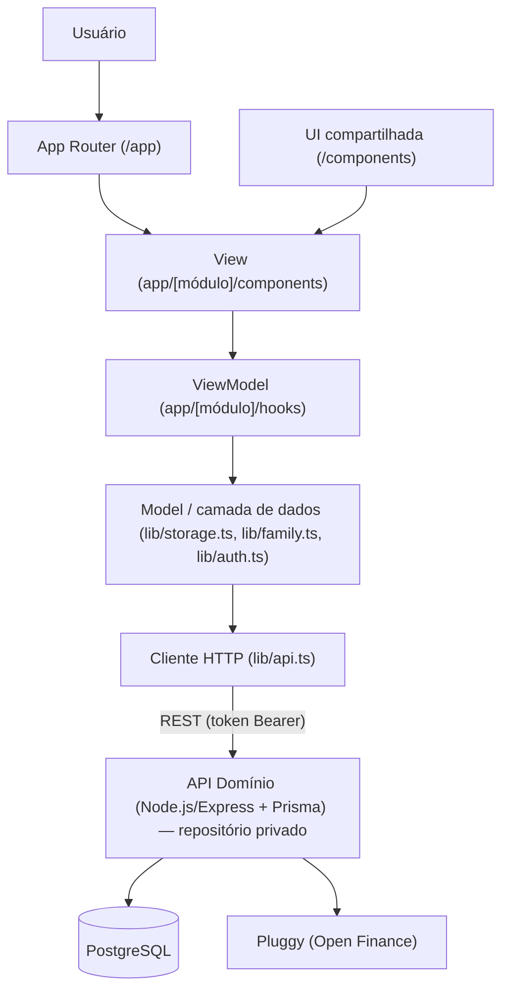

# Domínio

  

**Domínio** é um app de gestão financeira pessoal: controle de cartões e faturas, metas de economia, categorização de gastos, contas compartilhadas (casal/família) e sincronização bancária via Open Finance.

### 👉 [Acesse o app publicado: dominio-fawn.vercel.app](https://dominio-fawn.vercel.app)

---

## 📸 Screenshots

| Dashboard | Transações | Open Finance |
| :---: | :---: | :---: |
|  |  |  |

---

## 🏗 Arquitetura

Este repositório contém **somente o front-end** (Next.js). Todos os dados vivem no servidor: o front consome uma **API própria**, escrita em Node.js/Express com Prisma e PostgreSQL, que fica em um **repositório privado**. A API também é quem conversa com a **Pluggy** (Open Finance) e quem processa os arquivos de extrato importados.



O front segue o padrão **MVVM (Model-View-ViewModel)** adaptado ao Next.js App Router:

- **View**: cada rota em `app/[módulo]/page.tsx` apenas renderiza a View do módulo, em `app/[módulo]/components`.
- **ViewModel**: hooks `use-*-view-model.ts` em `app/[módulo]/hooks` concentram estado e regras da tela.
- **Model**: `lib/storage.ts` (e `lib/family.ts`, `lib/auth.ts`) é a camada de dados. Ela não persiste nada localmente: todas as leituras e gravações passam por `fetchApi` (`lib/api.ts`), que envia o token de sessão e, quando a conta do casal está ativa, o cabeçalho `X-Account-Id`.
- **UI compartilhada**: componentes globais e de layout em `/components` (incluindo os componentes base em `components/ui`).

> Alguns diálogos e componentes menores chamam a camada de dados diretamente, sem passar por um ViewModel.

---

## ✨ Funcionalidades principais

### Cartões, contas e faturas
- Cadastro de cartões de crédito, débito ou combinados (crédito + débito), contas correntes e poupança, com limite e dias de fechamento e vencimento. Toda conta nova já vem com uma carteira "Dinheiro".
- Mesclagem de dois cartões em um.
- Faturas de cartão por mês, com ajuste das datas de fechamento e vencimento e opção de mover um lançamento para a fatura anterior ou seguinte.
- Transferência de saldo entre contas.

### Transações
- Lançamento de receitas e despesas, com parcelamento e recorrência (diária, semanal, mensal ou anual).
- Contas a pagar/receber, com baixa (marcar como paga) e cancelamento.
- Tela de recorrentes, com assinaturas e parcelas, e cancelamento de uma recorrência.
- **Fechamento do Mês**: tudo que vence no mês, com as faturas de cartão e as pendências fora de cartão separadas em parcelas, recorrentes e avulsas.
- Central de notificações com contas vencidas ou que vencem hoje e transações do Open Finance aguardando revisão.

### Importação de extratos
- Upload de um ou mais arquivos de uma vez nos formatos **OFX, QFX, CSV, Excel (.xlsx) e PDF**.
- PDF é suportado para **fatura de cartão** do Banco do Brasil, Inter, Nubank e Santander, e para **extrato de conta** do Banco do Brasil, Inter, Nubank, Santander e Itaú.
- Antes de confirmar, uma tela de revisão mostra as transações agrupadas por categoria sugerida, marca duplicadas, detecta parcelas pela descrição (ex.: "Loja X 03/12") e reconhece quando um lançamento corresponde a uma pendência já cadastrada.

### Open Finance (Pluggy)
- Cada pessoa conecta a **própria conta da Pluggy** (clientId/clientSecret) e adiciona os bancos (itens) que autorizou por lá.
- As contas do banco são vinculadas aos cartões/contas do app, e as transações sincronizadas ficam numa fila de revisão antes de entrar no app.
- Transferências entre contas já vinculadas são reconhecidas e podem ser confirmadas de uma vez.

### Planejamento e análise
- Categorias de receita e despesa com ícone e cor, histórico por categoria e metas de gasto por categoria (percentual).
- Meta para o limite mensal de gastos.
- **Objetivos** (metas de economia) com aportes.
- **Reservas** (envelopes de dinheiro) vinculadas a uma conta.
- Estatísticas do mês com gráficos e filtros por cartão e por categoria.

### Contas compartilhadas (casal/família)
- Convite por link para conectar a sua conta à de outra pessoa: cada um vê os dados do outro em modo somente leitura.
- Criação de uma **conta do casal** compartilhada, com troca entre conta pessoal e do casal. Despesas e reservas pessoais podem ser marcadas como "do casal".
- Visão "Total da Família", com os números de todos os membros juntos.

### Outros
- Login e cadastro de usuário, edição de perfil e tema claro/escuro.

---

## 🧰 Stack do front-end

- **[Next.js](https://nextjs.org) 16** (App Router) + **React 19** + **TypeScript 5**
- **Tailwind CSS 4**, com componentes no estilo **shadcn/ui** sobre **Radix UI**
- **Phosphor Icons** e **Lucide** (ícones)
- **Recharts** (gráficos) e **Framer Motion** (animações)
- **React Hook Form** + **Zod** (formulários e validação)
- **date-fns** (datas), **next-themes** (tema claro/escuro)
- **Vercel Analytics**

---

## 🚀 Como rodar localmente

Pré-requisitos: Node.js e uma instância da API Domínio rodando (a API é privada e não faz parte deste repositório).

1. Instale as dependências:

   ```bash
   npm install
   ```

2. Configure a URL da API criando um arquivo `.env.local` na raiz do projeto:

   ```bash
   NEXT_PUBLIC_API_URL=http://localhost:3333
   ```

3. Rode o servidor de desenvolvimento:

   ```bash
   npm run dev
   ```

4. Acesse [http://localhost:3001](http://localhost:3001) (o script `dev` sobe o Next.js na porta 3001).

### Variáveis de ambiente

| Variável | Descrição | Obrigatória |
| --- | --- | :---: |
| `NEXT_PUBLIC_API_URL` | URL base da API Domínio, lida em `lib/api.ts`. Se não for definida, o front usa `http://localhost:3333`. | Não |

> Por começar com `NEXT_PUBLIC_`, o valor é embutido no bundle do navegador durante o build. Não coloque segredos nela.

---

## 📚 Documentação dos módulos

### Início e navegação

| Módulo | Descrição |
| :--- | :--- |
| **[Login](./app/login/README.md)** | Login e cadastro |
| **[All Menus](./app/all-menus/README.md)** | Mapa de navegação com todos os menus |
| **[Stats](./app/stats/README.md)** | Estatísticas do mês, gráficos e filtros |

### 💳 Contas e cartões

| Módulo | Descrição |
| :--- | :--- |
| **[Cards](./app/cards/README.md)** | Cartões e contas, importação de extratos |
| **[Invoices](./app/invoices/README.md)** | Faturas de cartão |
| **[Transfer](./app/transfer/README.md)** | Transferência entre contas |
| **Bank Sync** (`app/bank-sync`) | Sincronização bancária via Pluggy |

### 💸 Transações

| Módulo | Descrição |
| :--- | :--- |
| **[New](./app/new/README.md)** | Nova transação |
| **[Pending](./app/pending/README.md)** | Contas a pagar/receber |
| **[Recurring](./app/recurring/README.md)** | Assinaturas e parcelas |
| **Month Closing** (`app/month-closing`) | Fechamento do mês |

### 🎯 Planejamento e configurações

| Módulo | Descrição |
| :--- | :--- |
| **[Categories](./app/categories/README.md)** | Categorias e metas de gasto |
| **[Goals](./app/goals/README.md)** | Objetivos (metas de economia) |
| **[Savings](./app/savings/README.md)** | Reservas |
| **[Settings](./app/settings/README.md)** | Perfil, família, tema e metas |
| **Join** (`app/join/[token]`) | Aceite de convite da família |

---

## 📄 Licença

Distribuído sob a [PolyForm Noncommercial License 1.0.0](./LICENSE): o uso e a modificação são livres para fins não comerciais, e o uso comercial não é permitido.
